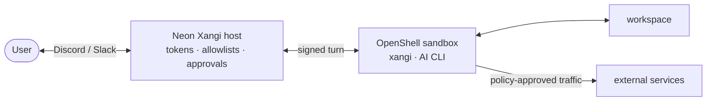

[日本語](README.md) | English

# Neon Xangi

Neon Xangi is an experimental reference implementation that runs [xangi](https://github.com/karaage0703/xangi) and an AI CLI inside an [NVIDIA OpenShell](https://github.com/NVIDIA/OpenShell) sandbox. Discord and Slack tokens stay on the host while policy limits the workspace, processes, and network available to the AI.

> [!CAUTION]
> This is an early experimental build. Security review and production hardening are incomplete. Begin with test credentials and a workspace that contains no sensitive data.

## Features

- Run xangi and the selected AI agent inside an OpenShell sandbox
- Limit workspace writes and external network access by profile
- Keep Discord and Slack tokens and API operations on the host
- Review approvals and audit logs; snapshot and rebuild state
- Complete guided setup and configuration in a local web UI

## Architecture



Platform tokens, sandbox lifecycle authority, policy changes, and approval decisions remain on the host. The sandbox receives only the selected workspace and short-lived capabilities.

## Quickstart

Neon Xangi requires Linux and a Docker-compatible image build environment.

1. Prepare one AI tool with the same helper used by xangi. This example installs Codex:

```bash
bash <(curl -fsSL https://github.com/karaage0703/xangi/releases/latest/download/setup-ai-tools.sh) codex
```

You can prepare `claude-code` or `github-copilot` instead of `codex`. xangi's built-in `local-llm` backend needs no additional AI CLI; select it in Settings and enter the host OpenAI-compatible API and model ID.

2. Install Neon Xangi and start its guided setup:

```bash
curl -fsSL https://raw.githubusercontent.com/karaage0703/neonxangi/main/install.sh | sh
neonxangi setup
```

Setup first asks which AI backend xangi should run inside the sandbox. It then recommends creating a fresh copy of [ai-assistant-workspace](https://github.com/karaage0703/ai-assistant-workspace), the starter kit recommended for xangi. You can instead choose an empty test workspace or an existing workspace that you explicitly name. The initial recommended profile is the read-only `observe` profile.

Setup first verifies the supported OpenShell CLI version and gateway connectivity. If OpenShell is missing, incompatible, or not connected to a gateway, it runs the version-pinned official OpenShell installer and verifies the result before starting the AI guide.

Next, open the settings UI:

```bash
neonxangi settings
```

To enable Discord or Slack, enter the tokens and the user/channel IDs allowed to receive responses. Neon Xangi stores tokens in its private area with mode `0600` and never displays them again. You do not need to create a credential file or provide a dotenv path.

Validate and start the stack:

```bash
neonxangi doctor
neonxangi sandbox create
neonxangi start
```

An installed Neon Xangi can verify the release checksum and switch to the latest release. The command does not restart a running host.

```bash
neonxangi update
```

See the [usage guide](docs/en/usage.md) for complete settings, profiles, and recovery procedures.

## Profiles

- `observe`: read-only workspace and no general external network access
- `develop`: read/write workspace with package registry and GitHub read access
- `research`: read-only workspace with named research destinations
- `operate`: read/write workspace with side effects controlled by the Broker and approvals
- `isolated`: disposable workspace with no general external network access

Codex provider-hosted web search, apps, browser, plugins, and MCP are disabled by default. Each profile's destination allowlist permits only direct traffic from commands inside the sandbox.

## Documentation

- [Usage](docs/en/usage.md)
- [Architecture design](docs/en/design.md)
- [Console UI design](docs/en/console-design.md)
- [Threat model](docs/en/threat-model.md)
- [Security verification](docs/en/security.md)

## Develop from source

Development requires Node.js 22.16 or newer and OpenShell 0.0.116.

```bash
npm ci
npm run build
npm link
neonxangi setup
```

Neon Xangi is MIT-licensed. xangi is MIT-licensed and OpenShell is Apache-2.0. See [licenses](licenses) for license information about bundled third-party software.
