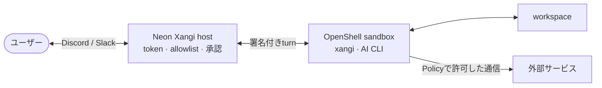

日本語 | [English](README.en.md)

# Neon Xangi

Neon Xangiは、[xangi](https://github.com/karaage0703/xangi)とAI CLIを[NVIDIA OpenShell](https://github.com/NVIDIA/OpenShell)のsandbox内で動かす実験的なリファレンス実装です。DiscordやSlackのtokenはhostに残し、AIが動くworkspace・process・networkをPolicyで制限します。

> [!CAUTION]
> 開発初期のExperimental版です。セキュリティ監査や本番保証は完了していません。最初はテスト用credentialと機密情報を含まないworkspaceで試してください。

## 主な機能

- xangiと選択したAIエージェントをOpenShell sandbox内で実行
- workspaceのread/writeと外部networkをprofileで制限
- Discord・SlackのtokenとAPI操作をhost側に分離
- 操作の承認、監査ログ、snapshotとrebuild
- AIガイド付きsetupとローカル設定画面

## アーキテクチャ



platform token、sandbox管理権限、Policy変更、承認判断はhostに残します。sandboxには選択したworkspaceと短寿命のcapabilityだけを渡します。

## Quickstart

LinuxとDocker互換のimage build環境が必要です。

1. xangiと同じセットアップスクリプトで、利用するAIツールを1つ準備します。例はCodexです。

```bash
bash <(curl -fsSL https://github.com/karaage0703/xangi/releases/latest/download/setup-ai-tools.sh) codex
```

`codex`の代わりに、`claude-code`または`github-copilot`も準備できます。xangi内蔵の`local-llm`を実行backendにする場合、追加のAI CLIは不要です。設定画面からhost上のOpenAI互換APIとmodel IDを指定します。

2. Neon Xangiをインストールし、対話セットアップを始めます。

```bash
curl -fsSL https://raw.githubusercontent.com/karaage0703/neonxangi/main/install.sh | sh
neonxangi setup
```

setupでは、sandbox内のxangiで使うAIバックエンドを選びます。続いてxangi向けスターターキットの[ai-assistant-workspace](https://github.com/karaage0703/ai-assistant-workspace)を新規取得する案を提案します。空のテスト用workspaceや、利用者が明示した既存workspaceも選べます。最初はread-onlyの`observe` profileを推奨します。

setupは最初にOpenShell CLIの対応versionとgateway接続を確認します。未導入・非対応・gateway未設定の場合は、version固定したOpenShell公式installerを実行し、導入後にもう一度確認してからAIガイドを開始します。

続いて設定画面を開きます。

```bash
neonxangi settings
```

DiscordまたはSlackを有効にする場合は、画面でtokenと応答を許可するuser/channel IDを入力します。tokenはNeon Xangiの専用領域へmode `0600`で保存され、設定画面には再表示されません。利用者がcredentialファイルやdotenvのpathを用意する必要はありません。

設定後は次の順で確認・起動します。

```bash
neonxangi doctor
neonxangi sandbox create
neonxangi start
```

インストール済みのNeon Xangiは、checksumを検証して最新Releaseへ切り替えられます。実行中のhostは自動で再起動しません。

```bash
neonxangi update
```

詳しい設定、profile、復旧手順は[使い方ガイド](docs/usage.md)を参照してください。

## Profile

- `observe`: workspaceはread-only、一般的な外部通信なし
- `develop`: workspaceはread/write、package registryとGitHub readを許可
- `research`: workspaceはread-only、指定した調査先だけ通信を許可
- `operate`: workspaceはread/write、副作用をBrokerと承認で制御
- `isolated`: 使い捨てworkspace、一般的な外部通信なし

Codexのprovider側Web検索、Apps、Browser、plugin、MCPは既定で無効です。各profileの通信先allowlistはsandbox内commandの直接通信だけを許可します。

## ドキュメント

- [使い方](docs/usage.md)
- [アーキテクチャ設計](docs/design.md)
- [Console UI設計](docs/console-design.md)
- [脅威モデル](docs/threat-model.md)
- [セキュリティ確認](docs/security.md)

## ソースから開発する

Node.js 22.16以降とOpenShell 0.0.116が必要です。

```bash
npm ci
npm run build
npm link
neonxangi setup
```

Neon XangiはMIT Licenseです。xangiはMIT License、OpenShellはApache-2.0です。同梱する第三者softwareのライセンス情報は[licenses](licenses)を参照してください。
